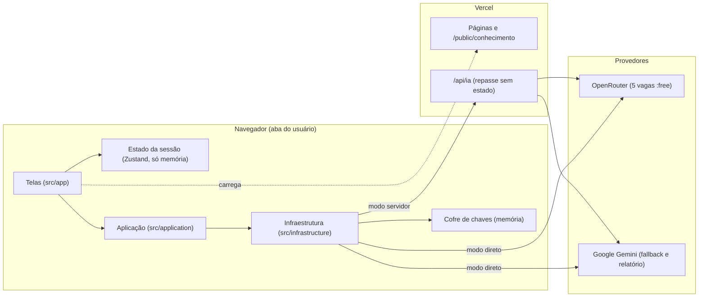
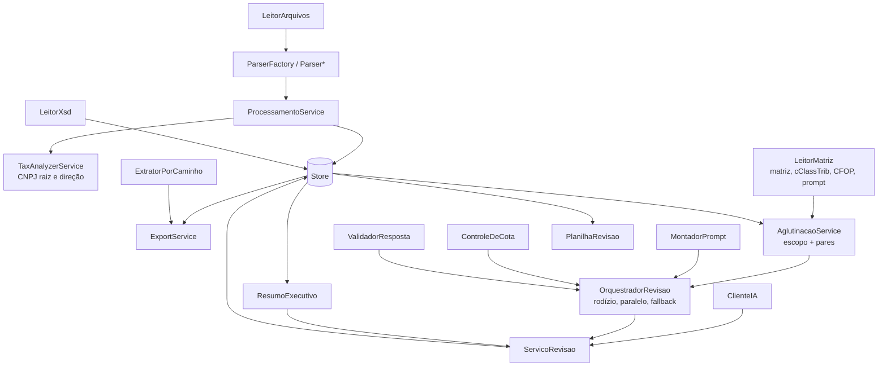

# 03 · Arquitetura

## Visão geral

Aplicação **Next.js 15 (App Router)** publicada na Vercel. Quase tudo roda **no navegador**: leitura dos XMLs, processamento, exportação, orquestração da IA e resumo. O servidor entrega as páginas estáticas e, opcionalmente, repassa chamadas de IA pela rota sem estado `/api/ia`.



## Camadas

| Camada | Pasta | Responsabilidade | Depende de |
|---|---|---|---|
| Domínio | `src/domain/models` | Tipos puros: documento fiscal, campos, matriz, revisão. | nada |
| Infraestrutura | `src/infrastructure` | Ler XML/ZIP/XSD, parsers, extração por caminho, HTTP dos provedores, cofre e redator. | domínio |
| Aplicação | `src/application` | Regras e casos de uso: catálogo, processamento, aglutinação, exportação, prompt, validação, cota, orquestrador, resumo, estado. | domínio, infraestrutura |
| Interface | `src/app`, `src/components` | Telas, componentes e hooks de tela. | aplicação |
| Servidor | `src/app/api/ia/route.ts` | Repasse opcional aos provedores. | nada do domínio |

Regras de dependência: o domínio não importa nada; a aplicação não importa React (exceto `store/`); o orquestrador não conhece HTTP (recebe a função de chamada por injeção).

## Componentes principais



## Tecnologia

| Item | Escolha | Motivo |
|---|---|---|
| Framework | Next.js 15, React 19 | Deploy nativo na Vercel; páginas estáticas + uma rota de servidor. |
| Linguagem | TypeScript estrito | Manutenção e segurança de tipos. |
| Estilo | Tailwind CSS 4 + classes de componente em `@layer components` | Identidade do projeto de origem; utilitários podem sobrescrever. |
| Estado | Zustand, sem `persist` | Simples e só em memória (RNF-01). |
| XML | fast-xml-parser (`parseTagValue: false`, `removeNSPrefix`) | Rápido, sem perder zeros à esquerda. |
| ZIP | JSZip | Leitura no navegador. |
| Planilhas | SheetJS 0.20.3 via `@e965/xlsx` (import dinâmico) | ADR-0003. |
| Markdown | react-markdown + remark-gfm | Passo a passo e relatório executivo. |
| Testes | Vitest (Node) | Rápidos; sem navegador nem internet. |

## Segurança (resumo)

Detalhes em `docs/SEGURANCA.md`. Chaves no `CofreSegredos` (variável de módulo, fora do estado); `Redator` mascara padrões de chave; CSP com `connect-src` restrito; `/api/ia` com lista fechada de provedores e caminhos, limite de 4 MB, sem log.

## Estrutura de pastas

```
src/
  app/                    telas por rota: /, /catalogo, /campos, /extracao, /exportacao,
                          /ia/configuracao, /ia/revisao, /resumo, /ajuda, /sobre; api/ia
  components/             ui/ (Cartao, Aviso, Selo, Estatistica...), layout/, ia/ (hooks), resumo/ (gráficos)
  domain/models/          FiscalDocument, Campos, Matriz, RevisaoIA
  application/            catalogo/, matriz/, services/, ia/, resumo/, store/
  infrastructure/         parsers/, xml/, xsd/, arquivos/, ia/
public/conhecimento/      Prompt-Mestre-RTC.md, Grupamentos-CFOP.md, classificacao_tributaria.json, cfop_oficial.json
public/modelos/           segredos-ia.modelo.json
tests/                    espelha src/; fixtures com XMLs reais anonimizados
docs/                     PASSO_A_PASSO, MANUTENCAO, SEGURANCA, REGISTRO_DE_DECISOES, adr/, sdd/, ia/
```
