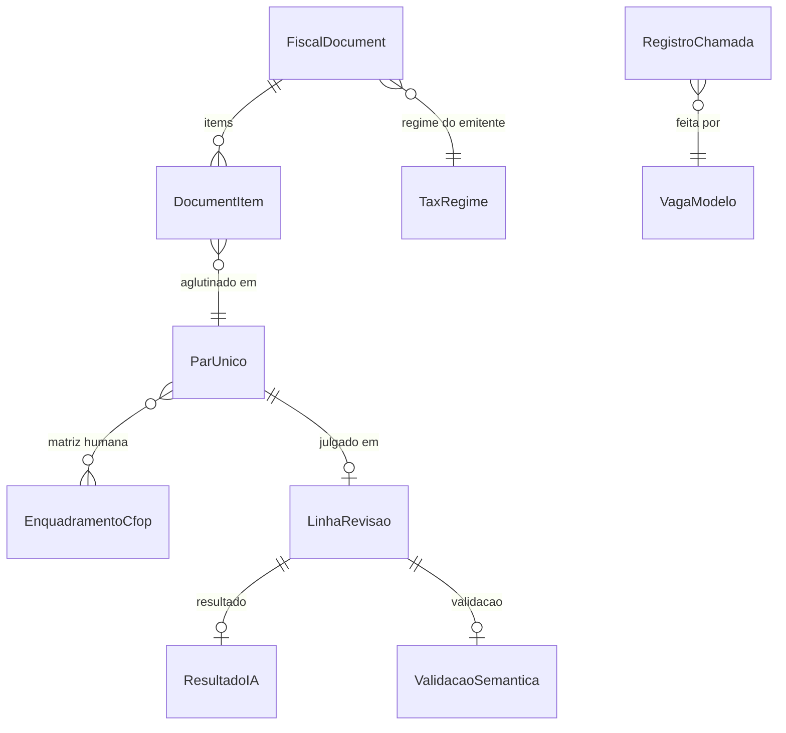

# 04 · Modelo de dados

Todos os tipos ficam em `src/domain/models`. Não há banco: as entidades vivem no estado da sessão (`useExtratorStore`) e saem em planilhas.

## FiscalDocument (`FiscalDocument.ts`)

Documento normalizado, comum aos quatro tipos. Campos principais:

| Campo | Tipo | Observação |
|---|---|---|
| `access_key` | string | Chave de acesso (usada para remover repetidos). |
| `document_type` | `'NFE' \| 'NFCE' \| 'CTE' \| 'NFSE'` | |
| `issue_date` | string ISO | |
| `purpose` | finalidade | NF-e `finNFe`, CT-e `finCTe`. |
| `tax_regime` | `'RPA' \| 'SIMPLES_EXCESSO' \| 'SIMPLES_NACIONAL' \| 'MEI' \| 'UNKNOWN'` | CRT 3, 2, 1, 4; NFS-e `opSimpNac` 1 = RPA, 2 = MEI, 3 = Simples. |
| `issuer`, `receiver` | `{ cnpj_cpf, name }` | |
| `direction` | `'INBOUND' \| 'OUTBOUND' \| 'UNKNOWN'` | Pela empresa analisada. Só descritivo (D24). |
| `items[]` | DocumentItem | `item_number`, `description`, `cfop`, `ncm`, valores, `taxes_current` (ICMS, PIS, COFINS, ISS), `rtc` (CST, cClassTrib, bases, alíquotas e valores de IBS UF/Mun e CBS). Na NFS-e, `cfop` guarda o cTribNac e **não** é usado como CFOP. |
| `totals` | DocumentTotals | Totais do documento, inclusive IBS/CBS. |

## Campos e perfis (`Campos.ts`)

`CampoCatalogo { id, rotulo, tipo, caminho, nivel ('documento'|'item'), tema, descricao?, origem ('catalogo'|'xsd') }`. Caminho absoluto a partir da raiz (`NFe/infNFe/ide/natOp`), sem invólucro de processamento; é de item se passa por `det` (NF-e/NFC-e). `PerfilSelecao { formato: 'extrator-xml-rtc/perfil-campos', versao: 1, campos[] }`.

## Base de conhecimento (`Matriz.ts`)

| Tipo | Origem | Conteúdo |
|---|---|---|
| `MatrizHumana { subgrupos[], porCfop: Map<cfop, EnquadramentoCfop[]> }` | `Grupamentos-CFOP.md` | `EnquadramentoCfop { grupo (I–V), subgrupo, essencia }`. |
| `TabelaClassificacao { registros[], porCClassTrib }` | `classificacao_tributaria.json` | Colunas usadas: CST, cClassTrib, descrição, "Redução de Alíquota". |
| `TabelaCfop { registros[], porCfop }` | `cfop_oficial.json` | `RegistroCfop { cfop, descricao, grupo, inicioVigencia }`. |

## Revisão (`RevisaoIA.ts`)

| Tipo | Campos |
|---|---|
| `ParUnico` | `id` (P001…), `cfop`, `descricaoCfop`, `cstAtual`, `cClassTribAtual`, `descricoesExemplo[]` (até 3), `tiposDocumento[]`, `ncms[]` (até 5, só humano), `qtdNcms`, `qtdItens`, `valorTotal`, `enquadramentos[]`, `sinalizacoes[]`. |
| `Sinalizacao` | `duplicidade_matriz`, `cfop_fora_matriz`, `cfop_inexistente`, `sem_classificacao`, `reducao_literalidade`. |
| `EscopoRevisao` | `regimesNoEscopo[]`, itens e valor no escopo e fora, `porRegime` (documentos, itens, valor). |
| `VagaModelo` | `posicao` (1–6), `provedor`, `modelo`, `rpm`, `ativo`. |
| `ParametrosExecucao` | `paresPorLote` (10), `cotaDiariaOpenRouter` (50), `cotaDiariaGemini` (200), `tempoLimiteSegundos` (180), `temperatura` (0,1), `modoConexao` (direto), `emParalelo` (true), `regimesNoEscopo` (RPA, SIMPLES_EXCESSO, UNKNOWN), `modeloResumo` (gemini-2.5-pro), `modeloResumoReserva` (gemini-2.5-flash). |
| `ResultadoIA` | Campos da seção 9 do Prompt Mestre (ver `08-CONTRATO-IA.md`). |
| `ValidacaoSemantica` | `ok`, `descricaoCClassTrib?`, `problemas[]`. |
| `LinhaRevisao` | `par`, `resultado?`, `validacao?`, `modeloJulgador?`, `provedor?`, `tentativas[]`, `julgadoEm?`, `revisaoHumanaObrigatoria`, `erro?`. |
| `RegistroChamada` | `lote`, `vaga`, `provedor`, `modelo`, `inicio`, `duracaoMs`, `status` (OK, PARCIAL, FALHA, PULADA), pares enviados e válidos, tokens, `mensagem`. |

## Resumo (`application/resumo/ResumoExecutivo.ts`)

`IndicadoresResumo { empresa, amostra, escopo, pares, revisao, conformidade (conforme, divergente, semClassificacao, naoJulgado: {pares, valor}; indicePorValor; indicePorPares), principaisOperacoes[], porGrupo[], pontos[], modelos[] }`.

## Planilhas

### Extração (`ExportService.montarPlanilhasExtracao`)

**Documentos:** Chave de Acesso, Tipo, Direção, Finalidade, Data Emissão, Emitente CNPJ, Emitente Nome, Destinatário CNPJ, Destinatário Nome, Regime, Valor Total (R$), Status, [RTC] Base IBS/CBS, [RTC] Total IBS, [RTC] Total CBS, [RTC] Saldo + campos extras de documento.

**Itens Analítico:** Chave de Acesso, Tipo Doc, Direção, Data Emissão, Emitente CNPJ/Nome, Destinatário CNPJ/Nome, Regime, Nº Item, Descrição, CFOP, NCM, Valor Bruto, Desconto, Valor Líquido, Impacto RTC, [RTC] CST, [RTC] cClassTrib, [RTC] Base, alíquotas e valores de IBS UF, IBS Mun, IBS Total e CBS, ICMS CST/Valor, PIS CST/Valor, COFINS CST/Valor, ISS Base/Alíquota/Valor + campos extras (documento e item).

**Sobre:** metadados e créditos.

### Revisão (`PlanilhaRevisao` + `ResumoExecutivo.planilhasResumo`)

| Aba | Conteúdo |
|---|---|
| Resumo Executivo | Indicadores em pares Indicador/Valor e o texto do relatório. |
| Principais Operações | CFOP, descrição oficial, matriz, pares, itens, valor, participação. |
| Pontos de Atenção | Tipo, par, CFOP, classificação atual, proposta, valor, detalhe. |
| Revisão IA | Par, CFOP, descrição oficial, descrições de exemplo, tipo doc, NCMs (conferência humana), qtd NCMs, qtd itens, valor, [Humano] grupo/subgrupo/essência, sinalizações, [XML] CST/cClassTrib, [IA] grupo, concorda com o grupo, parecer, CST e cClassTrib propostos, descrição oficial, classificação mantida, justificativa, fundamentação, passo a passo, quatro análises, red flags, dúvidas, documentação, confiança, validação, revisão humana obrigatória, modelo que julgou, vagas tentadas, julgado em, erro, aviso. |
| Comparativo Modelos | Por modelo: chamadas, falhas, julgados, concorda, diverge, proposta inicial, validação falhou, confiança baixa, tempo médio, tokens. |
| Chamadas IA | Uma linha por chamada (`RegistroChamada`). |
| Sobre | CNPJ raiz, totais, pares julgados, pares por chamada, versão do prompt, aviso. |
