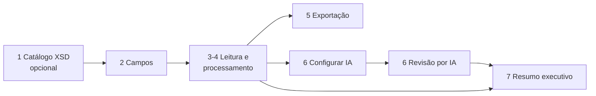
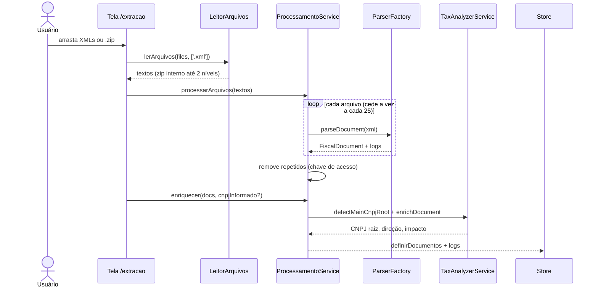
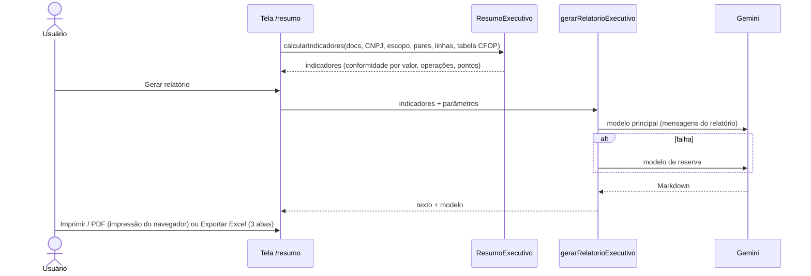

# 05 · Fluxos

## Visão de ponta a ponta



## F1 · Leitura e processamento



## F2 · Exportação da extração

1. `montarPlanilhasExtracao(documentos, camposSelecionados)` gera **Documentos** e **Itens Analítico**; os campos extras são lidos de cada XML por `extrairCampos` (caminho absoluto).
2. A tela acrescenta `abaSobre`.
3. `validarVolume` confere o limite do formato.
4. `gerarArquivo` carrega o SheetJS sob demanda (xlsx/xls) ou gera texto com BOM (csv `;`, txt `|`); várias abas de texto saem em `.zip`.
5. `baixar` dispara o download.

## F3 · Configuração da IA

1. Usuário carrega o arquivo de segredos → `interpretarArquivoSegredos` → `guardarChaves` (memória) → a tela mostra só `resumoChaves()` (mascaradas).
2. Opcional: `verificarChaveOpenRouter` ajusta a cota diária (50 ou 1.000).
3. `listarModelosOpenRouter` (público) traz os modelos; o usuário escolhe um por vaga.
4. Parâmetros, escopo por regime e modelos do relatório são ajustados (mudar o escopo limpa a revisão).
5. `useConhecimento` carrega os quatro arquivos de `/conhecimento` e permite trocá-los.

## F4 · Revisão por IA

```mermaid
sequenceDiagram
  actor U as Usuário
  participant T as Tela /ia/revisao
  participant AG as aglutinarPares
  participant SR as ServicoRevisao.revisar
  participant OQ as executarRevisao
  participant CC as ControleDeCota
  participant IA as Provedor (OpenRouter/Gemini)
  T->>AG: documentos + matriz + regimes + tabelas
  AG-->>T: pares (CFOP+CST+cClassTrib) + escopo
  U->>T: Iniciar revisão
  T->>SR: pares, vagas, parâmetros, prompt, tabela
  SR->>OQ: + controle de cota da sessão + chamar()
  par N tarefas (N = vagas OpenRouter ativas, se em paralelo)
    loop próximo lote livre
      loop cadeia: vaga do rodízio → outras OpenRouter → Gemini
        OQ->>CC: reservar(vaga, rpm, provedor)
        CC-->>OQ: ok / cota esgotada (pula a vaga)
        OQ->>IA: system = Prompt Mestre montado; user = lote em JSON
        IA-->>OQ: JSON de resultados
        OQ->>OQ: validarResposta (estrutura) + validarSemantica
        Note over OQ: válidos viram linhas; inválidos seguem para a próxima vaga
      end
    end
  end
  OQ-->>T: linhas (em tempo real) + chamadas
  U->>T: Exportar trabalho (resumo + revisão + comparativo + chamadas + sobre)
```

Detalhes:

- **Retentativa** (no `ClienteIA`): só erro de rede e HTTP 502/503/504, até 2 vezes, com espera de 1 s e 2 s. 429 e tempo esgotado passam direto ao próximo modelo.
- **Interrupção:** um `AbortController` cancela as chamadas em andamento; pares não iniciados recebem "interrompida".
- **Reprocessar não julgados:** roda o mesmo fluxo só com os pares sem resultado; o controle de cota da sessão continua contando.

## F5 · Resumo executivo


